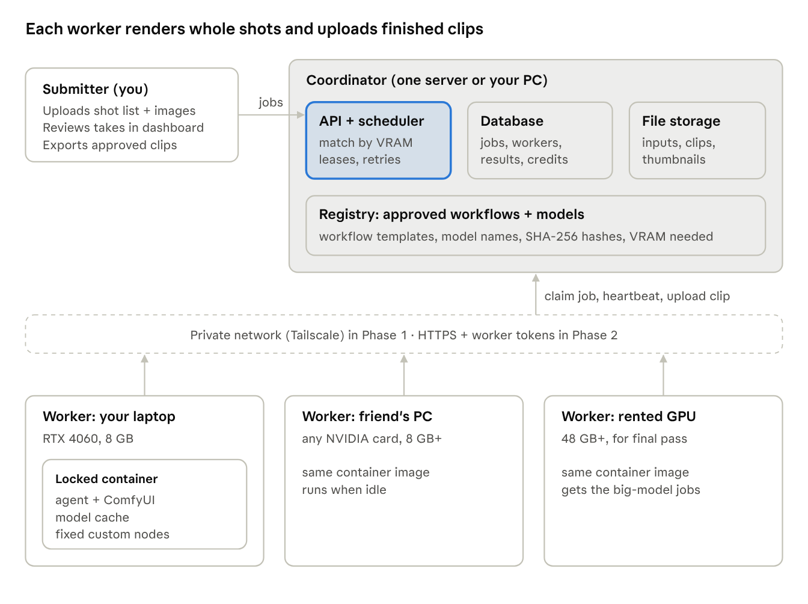

# Swarm Render: Distributed AI Video Network

**Defensive publication (prior art).** First published November 22, 2026.
Author: **HAPPY** ([@happyendings59](https://github.com/happyendings59)).

> **Notice.** This document is published openly so that the ideas in it are
> public, dated and free for anyone to use. It is intended as prior art: a
> public disclosure that prevents any person or company from later patenting,
> or claiming exclusive ownership of, the system and methods described here,
> including the variations listed in the final section. Nothing in this
> document is offered for patent protection by the author.
>
> The date of first publication is recorded by this repository's commit
> history and by any archived copies (see the README).

**Origin.** The concept (a pooled network of people's GPUs that is handed
tasks to build a movie from a script or storyboard, "torrents in reverse")
is the author's own. It grew out of needing compute for an AI legal
assistance project and then for AI video. The working name "Swarm Render"
and the wording of this write-up were drafted with an AI assistant (Claude,
by Anthropic) from the author's idea.

**Author's view.** This design is meant to stay open: anyone may build
and run it, and nobody should hold exclusive rights over it. In the
author's opinion, no license or permission should be needed for an
ordinary person to run a server that hands out rendering work for video
projects. Taxes on any income it earns are a separate matter.

**License.** This document and its figure are licensed under
[Creative Commons Attribution 4.0 International (CC BY 4.0)](https://creativecommons.org/licenses/by/4.0/).
Anyone may copy, share and build on it, including commercially, as long as
they credit the author. Code in this repository is licensed separately under
the GNU AGPL v3 (see `LICENSE`). The author intends the reference
implementation, when it is written, to be open source under the AGPL v3.

These licenses cover this text, its figure and the code in this
repository. They do not require anyone who builds their own system from
the ideas here to open their code; ideas are not covered by copyright.
What keeps the ideas free is this public, dated disclosure (prior art),
not the licenses.

---

## Overview

Swarm Render is a SETI@home-style network that renders AI video shots on
many separate GPUs and returns the clips to one place. Each worker
renders a **whole shot** by itself; nothing is split across the internet
mid-render, because home links are about 10,000 times slower than a
graphics card's memory.

**Problem.** One 8 GB laptop needs several evenings to render the 33
shots of The Beetle E01. Renting one big cloud GPU works but costs money
per hour, and a 32 GB card costs $3,300 or more to buy (Nov 2026).

**Goals**

- Render a queue of shots across many GPUs at once, at home or across
  the country.

- Use the ComfyUI workflows already built for The Beetle, unchanged.

- Send each job only to a machine with enough graphics memory for it.

- Never let a job run unapproved code on a volunteer's computer.

- Collect every finished clip, named by shot and take, in one folder.

**Non-goals**

- Splitting one model or one clip across several machines.

- Training models.

- Paying volunteers, or any crypto token.

- A public website for strangers to submit jobs (Phase 2 at the
  earliest).

**Phases**

1.  **Private swarm.** You plus a few trusted machines (your laptop,
    friends' PCs, rented GPUs) on a private Tailscale network.

2.  **Public volunteers.** Strangers install an agent and donate idle
    GPU time, SETI-style, earning credits on a leaderboard.

## Users and roles

| Role         | Who                                             | Can do                                                                                                                   |
|--------------|-------------------------------------------------|--------------------------------------------------------------------------------------------------------------------------|
| Submitter    | You (Phase 1); approved creators (Phase 2)      | Upload a shot list, start and cancel jobs, download clips, approve or reject takes                                       |
| Worker owner | Your machines, friends, volunteers, rented GPUs | Install the agent, set when it may run (idle only, hours, temperature limit), pause or quit any time, see credits earned |
| Admin        | You                                             | Approve workflows and models, ban workers, view all jobs and logs, change scheduling rules                               |

## System architecture

Three parts: one coordinator that holds the queue, a private network,
and any number of workers that pull jobs. Workers always call the
coordinator, never the other way, so no worker needs an open port.



*Figure 1. System architecture: coordinator, network, workers.*

A worker asks for a job, downloads the inputs, renders the shot in its
locked ComfyUI container, uploads the clip to storage, and asks again.
The coordinator never sends code, only an approved workflow ID and its
settings.

## Functional requirements

**Coordinator**

- **FR-1** Accept a job: an approved workflow ID, input files (start
  image, audio), parameters (prompt, size, frames, steps, seed), a
  priority and a shot label such as SH014.

- **FR-2** Accept a batch: a CSV or JSON shot list that creates one job
  per row, with a number of takes per shot.

- **FR-3** Keep each job in one state: queued, assigned, running,
  uploaded, done, failed or cancelled.

- **FR-4** Hand a job only to a worker that has the job's models, enough
  graphics memory (VRAM) and an allowed GPU type.

- **FR-5** Lease every assignment. A worker that sends no heartbeat for
  90 s loses the job, and it goes back to the queue.

- **FR-6** Retry a failed job up to 3 times on different workers, then
  mark it failed with the last error.

- **FR-7** Store results in object storage named
  E01/SH014_take3_seed12345.mp4, plus a thumbnail and the render log.

- **FR-8** Show a dashboard: queue, running jobs, worker list with GPU,
  VRAM, status and speed, and a gallery of results.

- **FR-9** Let the submitter mark a take approved or rejected, and
  export all approved takes as a zip or straight into the episode
  folder.

- **FR-10** Keep a registry of approved workflows (versioned) and models
  (name, size, SHA-256 hash, download URL, VRAM needed).

**Worker agent**

- **FR-11** On first run, detect GPU model, VRAM, driver, free disk and
  RAM, and register with the coordinator.

- **FR-12** Download required models from the registry URL, check each
  SHA-256 hash, and cache them. Never download the same file twice.

- **FR-13** Run ComfyUI headless inside a locked container and submit
  the job through ComfyUI's local API.

- **FR-14** Report progress (step x of y) every 10 s and send a
  heartbeat every 30 s.

- **FR-15** Upload the finished clip to a one-time upload URL, then
  report done with render time and peak VRAM.

- **FR-16** Run only when allowed: idle-only mode, a time window, and a
  GPU temperature cap. Stop within 10 s when the owner pauses.

- **FR-17** Clean up inputs and outputs after upload; keep only the
  model cache.

**Phase 2 additions**

- **FR-18** Volunteer sign-up with an account, a credit balance and a
  public leaderboard.

- **FR-19** Credits per finished job, weighted by GPU-seconds, and spent
  as queue priority.

- **FR-20** A worker reputation score: rises with approved results,
  falls with failures and rejected junk; low scores get only checked or
  low-priority jobs.

## Non-functional requirements

**Security (the part that matters most)**

- **NFR-1** Workers run only workflows from the approved registry. The
  job carries a workflow ID and parameters, never raw workflow JSON or
  code.

- **NFR-2** The worker image contains a fixed list of ComfyUI custom
  nodes. ComfyUI-Manager is removed, so nothing new can be installed at
  run time.

- **NFR-3** The container has no access to the host's files except its
  model cache and a scratch folder, and no network except the
  coordinator and the model download hosts.

- **NFR-4** Every model file is checked against its SHA-256 hash before
  loading. Only .safetensors or .gguf files are allowed, never pickle
  (.ckpt, .pt).

- **NFR-5** All traffic uses HTTPS (Phase 2) or Tailscale (Phase 1).
  Each worker has its own revocable token.

**Privacy**

- **NFR-6** Workers can see the prompts and images of the jobs they run.
  Anything private stays on your own machines; Phase 2 jobs are marked
  public or private and private jobs go only to trusted workers.

**Reliability**

- **NFR-7** A worker crash, sleep or reboot never loses a job (lease and
  retry, FR-5 and FR-6).

- **NFR-8** The coordinator restarts without losing the queue (state in
  a database, not memory).

**Performance**

- **NFR-9** Job hand-out under 2 s after a worker asks. Upload starts
  within 5 s of render end.

- **NFR-10** Phase 1 handles 50 workers and 1,000 queued jobs on one
  small server or your own PC.

**Usability**

- **NFR-11** A worker installs with one installer (Windows) or one
  command (Linux), and starts rendering with no settings changed.

## Data model and API

**A job as the worker receives it**

```json
{
  "job_id": "j_01HZX7",
  "shot": "E01/SH014",
  "take": 3,
  "workflow": {"id": "wan22_5b_i2v", "version": 4},
  "models": ["wan2.2_ti2v_5B_fp16", "umt5_xxl_fp8_e4m3fn_scaled", "wan2.2_vae"],
  "min_vram_gb": 8,
  "params": {
    "prompt": "a man in a wet coat stands in the rain at night, slow push in",
    "width": 832, "height": 480, "frames": 73, "steps": 20, "cfg": 5, "seed": 12345
  },
  "inputs": {"start_image": "https://.../signed/SH014_start.png"},
  "upload_url": "https://.../signed-put/SH014_take3.mp4",
  "lease_seconds": 90
}
```

**Database tables**

| Table     | Key columns                                                                                                                         |
|-----------|-------------------------------------------------------------------------------------------------------------------------------------|
| workflows | id, version, name, template JSON, parameter map (which node and field each param fills), required models, min VRAM, approved        |
| models    | name, file name, folder (diffusion_models, vae...), size, sha256, url, license                                                      |
| jobs      | id, batch_id, shot, take, workflow id+version, params, status, priority, attempts, worker_id, lease_until, created, finished, error |
| results   | job_id, file key, thumbnail key, render seconds, peak VRAM, review (pending/approved/rejected)                                      |
| workers   | id, owner, token hash, GPU, VRAM, driver, models cached, last heartbeat, status, reputation, credits                                |
| batches   | id, name (for example E01 draft pass), created by, job counts by status                                                             |

**Worker API** (worker calls coordinator)

| Method and path             | Does                                                     |
|-----------------------------|----------------------------------------------------------|
| POST /v1/workers/register   | Sends hardware info, gets a worker ID and token          |
| POST /v1/workers/heartbeat  | Every 30 s; lists cached models and status               |
| POST /v1/jobs/claim         | Asks for the next job it can run; empty reply means wait |
| POST /v1/jobs/{id}/progress | Step count and log tail                                  |
| POST /v1/jobs/{id}/complete | Render time, peak VRAM, result key                       |
| POST /v1/jobs/{id}/fail     | Error text; job returns to queue                         |
| GET /v1/models/{name}       | Download URL and hash                                    |

**Submitter API and dashboard**

| Method and path                  | Does                                                  |
|----------------------------------|-------------------------------------------------------|
| POST /v1/batches                 | Upload a shot list (CSV or JSON) and its input images |
| GET /v1/batches/{id}             | Progress of a batch                                   |
| POST /v1/jobs/{id}/cancel        | Cancel one job                                        |
| POST /v1/results/{job_id}/review | Approve or reject a take                              |
| GET /v1/batches/{id}/export      | Zip of approved takes                                 |
| GET /v1/workers                  | Worker list for the dashboard                         |

## Tech stack and repo layout

Python end to end, so the worker and coordinator share one job schema
and ComfyUI's own language.

| Part            | Choice                                                                                         | Why                                                                 |
|-----------------|------------------------------------------------------------------------------------------------|---------------------------------------------------------------------|
| Coordinator API | Python, FastAPI                                                                                | Small, typed, auto-generated API docs                               |
| Database        | SQLite (Phase 1), Postgres (Phase 2)                                                           | SQLite needs no server; same code via SQLAlchemy                    |
| Job claim       | Database row lock (SELECT ... FOR UPDATE SKIP LOCKED on Postgres)                              | No extra queue server to run                                        |
| File storage    | Local folder (Phase 1), S3-compatible bucket such as Cloudflare R2 or MinIO (Phase 2)          | Signed URLs let workers upload directly                             |
| Dashboard       | Server-rendered HTML with htmx                                                                 | One codebase, no separate front-end build                           |
| Worker agent    | Python service plus ComfyUI, in Docker with NVIDIA Container Toolkit (Linux) or WSL2 (Windows) | Locked-down container; ComfyUI driven through its local /prompt API |
| Private network | Tailscale                                                                                      | Joins machines anywhere with no port forwarding                     |
| Packaging       | Docker image for workers; docker compose for the coordinator                                   | One command to start each side                                      |

**Repo layout**

```text
swarm-render/
  coordinator/
    app/main.py          # FastAPI routes
    app/models.py        # database tables
    app/scheduler.py     # matching, leases, retries
    app/storage.py       # local folder or S3
    app/templates/       # dashboard pages
  worker/
    agent.py             # register, claim, run, upload loop
    comfy_client.py      # talks to ComfyUI's local API
    model_cache.py       # download and hash check
    Dockerfile           # ComfyUI + fixed custom nodes
  shared/schema.py       # job and result definitions
  workflows/             # approved workflow templates + param maps
  tools/submit_shotlist.py
  tests/
  docker-compose.yml
```

## Build plan

Each milestone ends with something you can run and check. M1 to M5 make
up Phase 1.

1.  **M1 · One worker, one job, on your laptop.** Coordinator with
    SQLite and a local folder; worker agent drives your existing
    ComfyUI.

    - Done when: a command submits the pig test clip, the laptop renders
      it, and the .mp4 appears in the coordinator's results folder.

2.  **M2 · Workflow templates and shot lists.** Parameter maps for the
    Wan 2.2 5B and Z-Image workflows; CSV shot-list import.

    - Done when: a 5-row shot list becomes 5 jobs that render with the
      right prompt, size and seed each.

3.  **M3 · Several workers, leases and retries.** Matching by VRAM and
    models; heartbeats; job returns to queue when a worker drops.

    - Done when: with two machines on Tailscale, unplugging one
      mid-render sends its job to the other, and the batch still
      completes.

4.  **M4 · Locked worker container and model cache.** Docker image with
    fixed custom nodes, hash-checked model downloads, no Manager.

    - Done when: a fresh PC goes from installer to first finished job
      with no manual model moving, and a job naming an unapproved
      workflow is refused.

5.  **M5 · Dashboard and review.** Queue, workers, gallery, approve or
    reject, export approved takes.

    - Done when: all 33 E01 draft shots render across the swarm and you
      pick takes from the gallery.

6.  **M6 · Phase 2 foundations.** Postgres, S3 storage, accounts,
    credits, leaderboard, reputation, public and private jobs.

    - Done when: an outside volunteer installs the agent, renders public
      jobs, and sees credits on the leaderboard.

7.  **M7 · Hardening.** Rate limits, token revocation, abuse reporting,
    spot-check jobs with known good results.

    - Done when: a test worker that returns junk loses reputation and
      stops getting jobs.

## Risks and open questions

| Risk                                                                   | Effect                                                      | Plan                                                                           |
|------------------------------------------------------------------------|-------------------------------------------------------------|--------------------------------------------------------------------------------|
| A workflow or custom node runs harmful code on a volunteer's PC        | Malware spread through your network; your name on it        | Approved workflows only, fixed node list, locked container (NFR-1 to NFR-4)    |
| Volunteers return junk or swapped clips                                | Wasted renders, bad takes                                   | Reputation score, spot-check jobs, you review every take before export         |
| Two GPUs never give byte-identical output                              | SETI-style double-checking by comparing files does not work | Human or automatic visual check instead of hash match                          |
| Model downloads of 20 to 40 GB per worker                              | Slow first start; bandwidth cost if you host files          | Workers download from Hugging Face directly; cache forever                     |
| Volunteers pay for electricity (a card at full load draws about 300 W) | Few Phase 2 volunteers                                      | Credits buy queue priority; leaderboard; Phase 1 does not depend on volunteers |
| Model licenses change                                                  | Commercial use of the episode at risk                       | Model registry stores the license; only Apache 2.0 or similar for public jobs  |
| Prompts and images visible to workers                                  | Unreleased episode leaks                                    | Private jobs go only to trusted workers (NFR-6)                                |

**Open questions**

- Windows workers: Docker with WSL2, or a plain Windows install of the
  portable ComfyUI with a stricter node allow-list?

- Phase 2 hosting: your own PC behind Tailscale Funnel, or a small cloud
  server?

- Build on an existing network instead (AI Horde for volunteers,
  ComfyUI-Distributed for the private swarm) and only add what is
  missing?

- Project name: Swarm Render is a placeholder.


## Additional variations disclosed

The system above is one embodiment. The following variations are also
disclosed and are equally part of this publication:

- **Script and storyboard to shot queue.** A film script, screenplay,
  book chapter or storyboard is broken down, manually or automatically
  (for example by a language model), into a numbered shot list with a
  prompt, duration, camera direction, reference images and audio for each
  shot. Each shot becomes one or more render jobs in the queue.
- **Assembly.** Finished, approved shots are joined automatically in
  shot order into scenes, episodes or a full film, with dialogue,
  narration, music, sound effects and subtitle tracks added from the
  same shot list.
- **"Reverse torrent" model.** Instead of many peers each downloading
  pieces of one finished file, many peers each *produce* pieces (shots,
  frames, audio stems, upscales or interpolations) of a work that does
  not yet exist, which are then gathered into one finished work.
- **Paid contributors.** Contributors are paid for GPU time or finished
  jobs in money, platform credit, revenue share in the finished work,
  or any token or points system, priced per GPU-second, per job or per
  approved take, with payment held until the submitter approves the
  result.
- **Other job types.** The same queue distributes image generation,
  upscaling, frame interpolation, voice and music generation, lip-sync,
  subtitle translation and transcoding, not only video shots.
- **Non-video AI workloads.** The same pooled-GPU network, with the same
  coordinator, leases, approved-model registry, locked workers, credits
  and payments, runs any AI workload: large language model inference
  (for example powering an AI legal-assistance service that answers
  questions, drafts documents or reviews case files for people who
  cannot afford a lawyer), document analysis, speech-to-text,
  translation, embeddings and search indexing, and fine-tuning or
  evaluation jobs. Private or sensitive jobs, such as a person's legal
  documents, go only to trusted or self-owned workers, or are processed
  so that workers never see identifying details.
- **Splitting below the shot level.** A long shot may be split into
  overlapping segments rendered on different machines and blended at
  the joins, or the same shot rendered as several takes on different
  machines for the submitter to choose from.
- **Any model, any runtime.** Any generative model or pipeline may be
  used in place of ComfyUI and the models named above, on consumer,
  workstation, data-centre or rented cloud GPUs, NPUs or other
  accelerators, over any network.
- **Any trust model.** Workers may be the submitter's own machines,
  friends, paid cloud instances, anonymous volunteers, or a marketplace
  where submitters and GPU owners find each other, with verification by
  reputation, spot-check jobs, duplicate rendering or human review.
